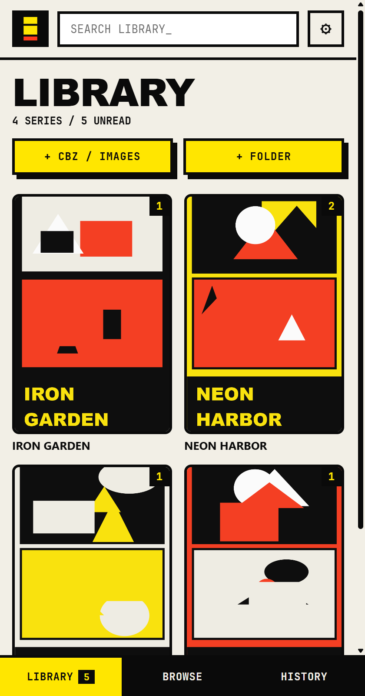
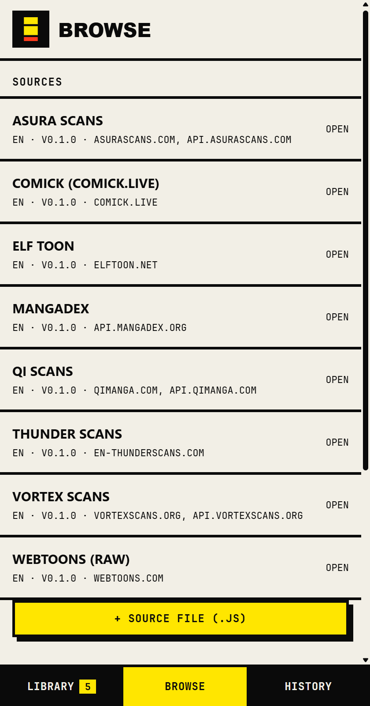
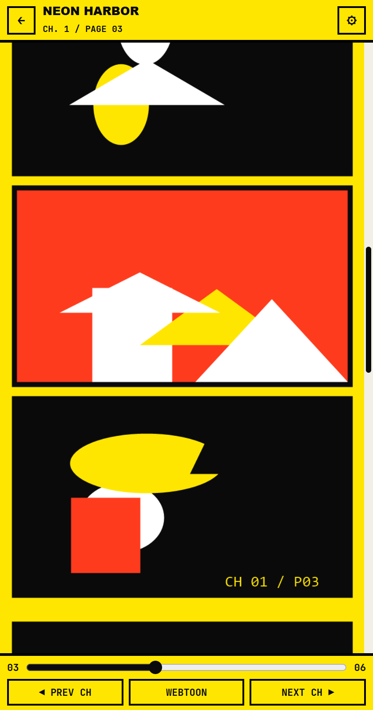

# RAW

A small Windows reader for manhwa, manhua and manga. It runs as a narrow portrait window, scrolls like a phone app, and the whole program is about 3 MB.

<p>
  
  
  
</p>

The screenshots use demo comics drawn for this repo, so no third-party artwork is included.

## What it does

- **Reader.** Continuous scrolling that flows from one chapter into the next, or paged left-to-right / right-to-left. The top and bottom bars hide while you scroll down and come back when you scroll up or tap the middle of the page. A slider jumps between pages.
- **Library, History, Resume.** Add titles to your library, see unread counts, and pick up where you stopped. Everything is kept between sessions.
- **Sources.** Browse and search a site, switch between Popular and Latest, and filter by Manhwa, Manhua or Manga where the site supports it.
- **Local files.** Open CBZ/ZIP archives, loose images or a whole folder. (Local files last until you close the app.)
- **Small and contained.** No telemetry, no accounts, no background service.

Bundled sources: MangaDex, Webtoons (Originals), Asura Scans, Qi Scans, Thunder Scans, Vortex Scans, Elf Toon and Comick (comick.live, an unofficial copy). You can also add your own, see [docs/WRITING-SOURCES.md](docs/WRITING-SOURCES.md).

Under **Browse → Extension store** you can load a Mangayomi index and install its JavaScript sources. A Mihon/Keiyoushi `index.pb` can be listed too, but those extensions are Android APKs and cannot run here.

## Keyboard

| Key | Action |
|---|---|
| `M` | show / hide the bars |
| `[` / `]` | previous / next chapter |
| `Space`, `PageDown`, `PageUp` | scroll (continuous mode) |
| `←` `→` | turn the page (paged modes) |
| `Esc` | back to the title |

## Build

You need Windows 10 or 11 (with WebView2, already included in Windows 11), [Rust](https://rustup.rs), and the Visual Studio Build Tools with the **Desktop development with C++** workload.

```bat
scripts\build.cmd
```

This produces `src-tauri\target\release\raw-reader.exe`. The first build downloads and compiles the dependencies and takes several minutes.

For an installer (per-user, no admin rights needed):

```bat
cargo install tauri-cli --version "^2" --locked
scripts\package.cmd
```

The installer ends up in `src-tauri\target\release\bundle\nsis\`.

### Working on the interface

The interface is plain HTML, CSS and JavaScript in [`app/`](app) with no build step. To work on it in a browser:

```bat
node scripts\serve.mjs
```

then open http://127.0.0.1:5173. In a browser, requests to other sites are limited by CORS; the desktop app routes them through the Rust side instead.

## How it is put together

```
app/          interface and source runtime (HTML, CSS, JavaScript)
  extensions/ bundled sources
  sandbox.*   isolated page where Mangayomi-style sources run
src-tauri/    Rust shell (Tauri 2): window, network bridge
scripts/      build, package and dev-server scripts
docs/         notes for source authors
```

- Sources never get the network directly. They call one function, and the app only lets them reach the hosts they declared.
- The Rust side accepts `https` only, refuses IP addresses and `localhost`, follows redirects only to declared hosts, and caps response size and time.
- Opening a website from the app only works for `https` links and goes to your default browser.

## Limits

- Paid, locked and early-access chapters are skipped. RAW does not unlock anything.
- Sites change. A source that works today can break when its site changes; sources are small files and easy to fix.
- There are no automated tests yet.

## Disclaimer

RAW ships no comics. It is a reader: it opens what you point it at. What you read, and whether you have the right to read it, is up to you and the sites you use. Some bundled sources point at unofficial sites. RAW is not affiliated with, or endorsed by, MangaDex, Webtoons, Mihon, Mangayomi, Keiyoushi or any site it can read from.

## Credits

The source and store formats follow the ideas of [Mihon](https://github.com/mihonapp/mihon), [Mangayomi](https://github.com/kodjodevf/mangayomi) and [Keiyoushi](https://github.com/keiyoushi/extensions). Built with [Tauri](https://tauri.app).

## License

[MIT](LICENSE)
